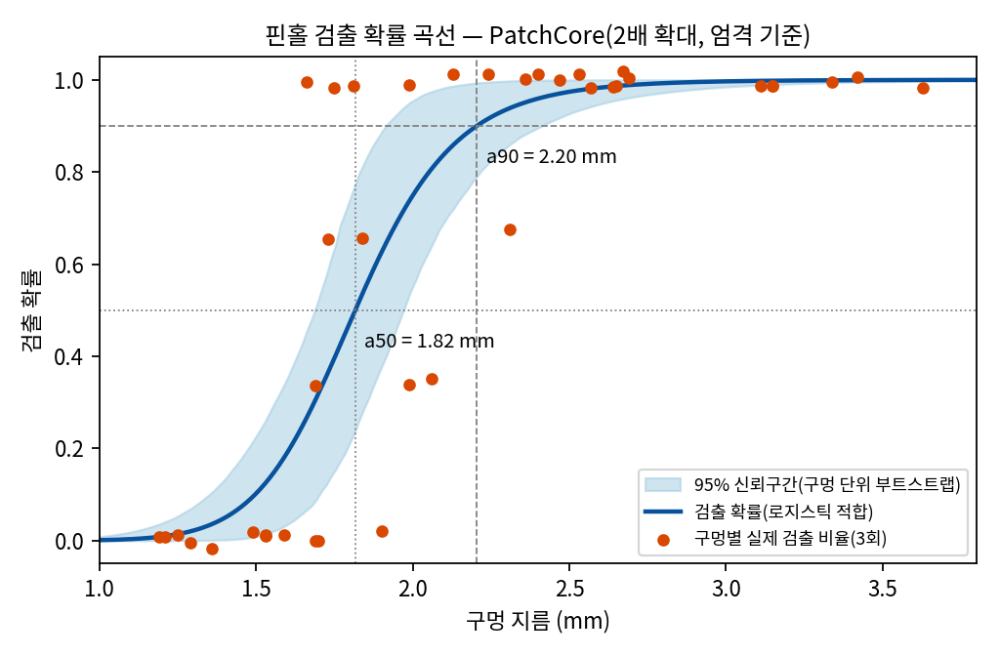
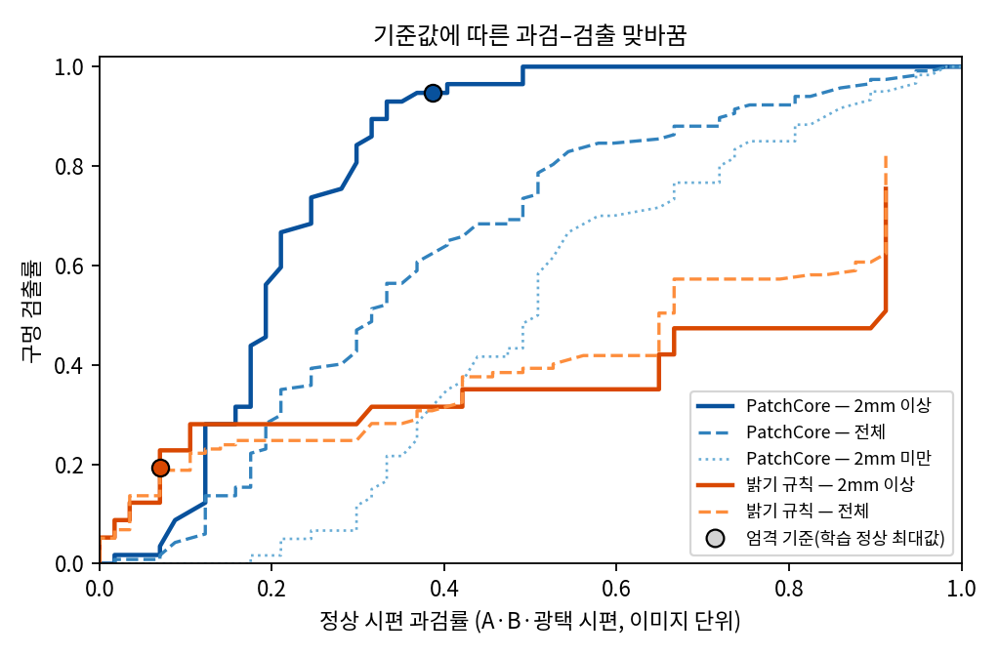
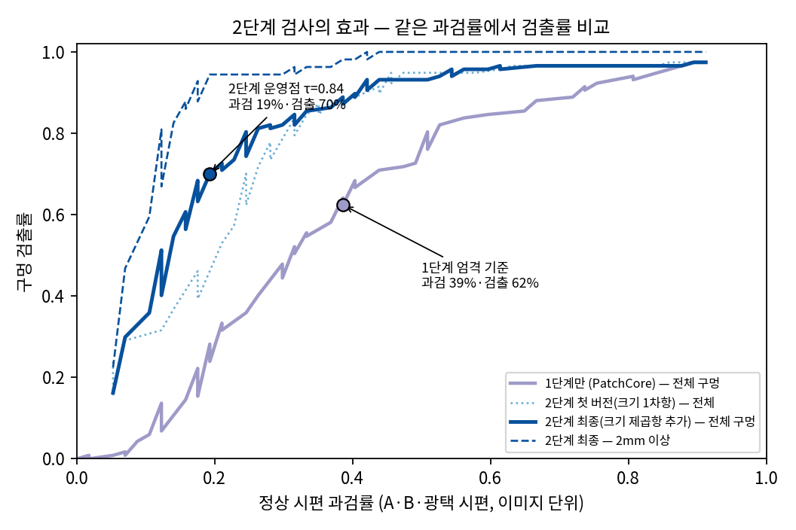
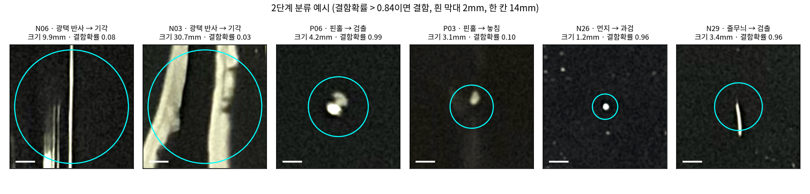
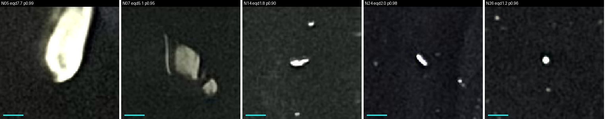
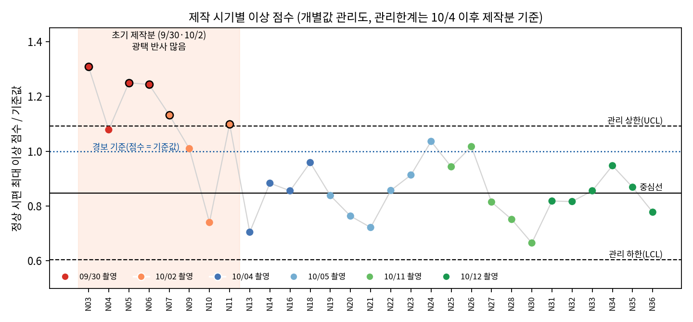

# 모사 전극 시편 핀홀 검사 — 이상탐지(PatchCore) + 영역 분류 2단계 검사

검은 아크릴 물감을 알루미늄 호일에 도포해 전극 코팅을 모사한 시편 45장을 직접 만들고, 스마트폰으로 촬영해 핀홀 검사 모델을 만들었다. 정상 사진만으로 학습하는 이상탐지(PatchCore)를 1단계로, 이상 영역을 "핀홀 / 비결함"으로 나누는 분류기를 2단계로 붙였다.

## 요약

| 항목 | 결과 |
|---|---|
| 데이터 | 시편 45장(정상 29 · 핀홀 11 · 이물 2 · 줄무늬 3), 핀홀 44개 중 평가 대상 39개(지름 1.2~3.6mm) |
| 검출 한계 (1단계, 엄격 기준) | **a90 = 2.2mm** (95% 신뢰구간 1.9~2.4mm), a50 = 1.8mm |
| 2단계 효과 | 같은 정상 과검률 20%에서 구멍 검출률 **28% → 70%**. 검출 80%에 필요한 과검률 51% → 25% |
| 과검 원인 | ① 초기 제작분의 광택 반사 → 2단계에서 제거 ② 1~1.5mm 하얀 표면 입자 → 이 영상(측면광 1장)으로는 핀홀과 구분 불가 |
| 공정 관점 | 정상 시편의 이상 점수를 제작 순서로 관리도에 그리면, 초기 제작분 8장 중 5장이 관리 상한 초과 → 모델이 제작 시기별 표면 상태 변동을 감지 |

모든 숫자는 정상 A등급 17장을 3묶음으로 나눈 3회 교차 검증의 합계다. 데이터가 작으므로 절대값보다 비교(1단계 대 2단계, 크기별 경향)를 중심으로 읽어야 한다. 한계는 [LIMITATIONS.md](LIMITATIONS.md), 주요 판단과 이유는 [DECISIONS.md](DECISIONS.md)에 정리했다.

---

## 1. 목표

- 전극 코팅의 대표 결함인 핀홀(코팅 결손으로 집전체 노출)을 이미지로 검출한다.
- 결함 데이터가 적은 현실을 반영해, **정상 사진만으로 학습하는 이상탐지**를 출발점으로 삼는다.
- 결과를 "정확도"가 아니라 검사 장비 스펙 형식(검출 한계, 과검률)으로 표현한다.

## 2. 데이터

### 2-1. 시편 제작

| 항목 | 내용 |
|---|---|
| 기재 | 알루미늄 호일(무광면) |
| 코팅 | 검은 아크릴 물감 원액, 카드 긴 변으로 1회 당겨 도포. 띠 폭 5.9~8.0cm(행별 중앙값), 길이 15~20cm |
| 핀홀 | 도포 직후 2분 안에 구멍 4개(위·가운데·아래 좌우). 면봉 솜 = 큰·중간 구멍, 면봉을 잘라 나온 나무 끝 = 작은 구멍 |
| 결함(자연 발생) | 이물 2장(보풀·섬유가 물감에 박힘), 줄무늬 3장(카드 날의 굳은 물감 부스러기가 끌림) |

### 2-2. 촬영

iPhone 17, 삼각대, 렌즈~판 50cm, 2배 줌, 3024×4032 HEIC. 조명은 손전등 하나를 왼쪽 바닥 가까이에 둔 측면광. 자(약 10.4 px/mm)와 흰 종이(밝기 기준)를 함께 찍었다.

### 2-3. 품질 점검 (`src/qc/`)

- **띠·검사 영역 자동 추출**: 띠 밝기와 판 밝기 사이 임계값으로 띠 윤곽을 찾고, 가장자리 5mm·위아래 1cm 안쪽을 검사 영역으로 둔다. 45장 모두 육안 확인.
- **흰 종이 보정**: 장마다 다른 노출(1/14~1/20초, ISO 400~640)을 흰 종이 밝기로 맞춘다.
- **먼지 등급**: 검사 영역 안 밝은 점(top-hat, 노이즈 대비 8σ 이상) 밀도 1.8개/cm² 미만을 A, 이상을 B로 판정. 눈으로 등급을 매긴 17장과 17/17 일치(A 최대 1.73, B 최소 1.88). 결과: **A 17장, B 12장**.
- **핀홀 정답 라벨** (`data/holes_labels.csv`): 원본에서 구멍 44개의 중심 좌표와 지름을 측정. 평가 대상 39개(1~1.5mm 6 · 1.5~2mm 14 · 2~2.5mm 7 · 2.5~3mm 6 · 3mm 이상 6), 1mm 미만 4개와 보이지 않는 1개는 평가에서 제외.

## 3. 방법

### 3-1. 1단계: PatchCore (`src/patchcore/`)

- 특징: ImageNet 사전학습 WideResNet-50의 layer2+layer3 → 3×3 평균 → 384차원 무작위 투영. 메모리 뱅크는 탐욕적 코어셋 10%.
- 입력: 흰 종이로 보정한 띠 영역을 **2배 확대**해 입력(특징 한 칸 ≈ 0.38mm).
- 학습: 정상 A만 사용. 광택 반사가 심한 N03·N06은 학습에서 빼고 테스트로 보냄.
- 검증: A 15장을 5장씩 3묶음으로 나눠 3회 교차 검증. B 12장, 핀홀 11장, 이물 2장, 줄무늬 3장은 항상 테스트.
- 경보 기준값: **엄격**(학습 정상 이미지를 하나씩 빼고 잰 최대 점수) / **완화**(같은 점수의 99.9%).
- 실행 환경: Google Colab T4.

### 3-2. 비교 기준: 밝기 규칙 (`src/qc/rule_baseline.py`)

같은 검사 영역에서 top-hat 대비가 가장 큰 값을 점수로 쓰고, 같은 3묶음·같은 기준값 방식으로 평가했다.

### 3-3. 2단계: 영역 분류 (`src/stage2/`)

1. 1단계 점수 지도에서 점수 ÷ 기준값이 0.75를 넘는 칸을 이어 후보 영역을 만든다(평가 구멍 117건 중 114건 포함).
2. 영역마다 크기, 길쭉한 정도, 점수(최대·평균), 원본 밝기, 주변 대비, 포화 비율을 잰다.
3. 로지스틱 회귀로 "핀홀 / 비결함"을 판정한다. 구멍보다 훨씬 큰 반사 덩어리를 결함으로 외삽하는 문제가 있어 크기 제곱항을 넣었다.
4. **시편 단위로 묶은 6겹 교차 검증**으로 확률을 낸다. 같은 시편이 학습과 평가에 함께 들어가지 않는다.

위치·가장자리 거리 특징은 일부러 쓰지 않았다. 구멍을 가장자리에서 떨어뜨려 만들었기 때문에, 쓰면 "가장자리 근처는 정상"이라는 편향을 배운다.

## 4. 결과

### 4-1. 1단계 PatchCore — 실행별 비교 (엄격 기준, 3회 합계)

| 실행 | 정상 A 과검 | 정상 B 과검 | 구멍 검출 | 1~1.5 | 1.5~2 | 2~2.5 | 2.5~3 | 3mm+ |
|---|---|---|---|---|---|---|---|---|
| 1차 (원본 크기, 전체 A 학습) | 0/17 | 0/36 | 0% | 0% | 0% | 0% | 0% | 0% |
| A (광택 시편 학습 제외) | 2/15 | 16/36 | 47% | 11% | 26% | 67% | 72% | 83% |
| **B (A + 2배 확대)** | **2/15** | **14/36** | **62%** | **0%** | **43%** | **86%** | **100%** | **100%** |

1차에서 검출이 0%였던 이유는 기준값이 광택 반사 시편(N03·N06)에서 정해졌기 때문이다. 이 두 장을 빼자 검출이 47%로 올랐고, 2배 확대는 과검을 늘리지 않으면서 검출을 62%로 올렸다.

### 4-2. 검출 한계



구멍별 검출 여부(3회)를 지름의 로그에 대해 로지스틱으로 맞췄다. 신뢰구간은 구멍 단위 부트스트랩(2,000회).

### 4-3. 과검–검출 맞바꿈과 밝기 규칙 비교



| 엄격 기준 | 정상 과검 (A·B·광택) | 구멍 검출 | 3mm 이상 |
|---|---|---|---|
| 밝기 규칙 | 4/57 | 17% | **0%** |
| PatchCore | 22/57 | 62% | **100%** |

큰 구멍은 솜으로 만들어 가운데에 얇은 막이 남아 있고, 그래서 밝기만으로는 정상과 구분되지 않는다. PatchCore는 질감 차이로 이를 잡는다. 반대로 같은 이유로 광택 반사에도 반응한다.

### 4-4. 2단계 효과



| 정상 과검률 | 1단계만 | 2단계 |
|---|---|---|
| 약 10% | 6% | 36% |
| 약 20% | 28% | **70%** (2mm 이상 약 94%) |
| 약 30% | 48% | 82% |

운영점(결함 확률 > 0.84)에서 정상 과검은 A 2/15 · B 9/36 · 광택 시편 0/6(1단계 엄격 기준에서는 6/6), 구멍 검출 70%. 이물 0/6 · 줄무늬 3/9로, 같은 과검률의 1단계와 같다. 영역 단위 AUROC 0.91.

1단계와 2단계는 같은 "영역 기준"으로 셌다(구멍 반경 + 1mm 안의 영역이 경보면 검출). 그래서 4-1 표와 1~2mm 구간 숫자가 조금 다르다.



### 4-5. 남은 과검



운영점에서 남은 정상 과검은 5장이다. N05·N07은 4~8mm 넓은 광택 덩어리이고, **N14·N24·N26은 1~1.5mm 하얀 표면 입자**다. 입자와 핀홀은 이 영상에서 밝기, 밝은 핵 크기, 좌우 그림자 비대칭 어느 것으로도 구분되지 않았다. 밝은 핵 크기를 특징에 더한 버전도 성능이 같아(과검 20%에서 검출 69%) 채택하지 않았다.

볼록한 입자와 오목한 구멍을 가르려면 높이 정보가 필요하다. 다음 단계로 좌·우 두 방향 조명 촬영을 검토한다(7절).

## 5. 공정 관점 해석

### 5-1. 제작 시기별 관리도



정상 시편의 최대 이상 점수 ÷ 기준값을 제작 순서로 그렸다. 관리 한계는 10/4 이후 제작분 21장으로 잡았다(중심선 0.85, 상한 1.09). 초기 제작분(9/30·10/2) 8장 중 5장이 상한을 넘었고, 이후 21장은 모두 한계 안이다. 과검의 주원인인 광택 반사가 특정 제작 시기에 몰려 있었다는 뜻이고, 이상탐지 점수를 공정 변동 감시에 쓸 수 있음을 보여준다. 관리 한계를 결과를 본 뒤 정했다는 점은 한계로 남긴다.

### 5-2. 결함–원인 대응

| 결함 | 모사 원인 | 실제 공정에서의 원인 후보 | 이번 검사 결과 |
|---|---|---|---|
| 핀홀 | 면봉·나무 끝으로 젖은 물감을 걷어냄 | 슬러리 기포, 탈포 불량, 건조 중 용매 급속 휘발 | a90 2.2mm, 2단계로 과검 감소 |
| 줄무늬 | 카드 날에 굳은 물감 부스러기가 끌림 | 코터 다이 립 이물·응집체 걸림, 블레이드 손상 | 3장 중 일부만 경보 |
| 이물 | 보풀·섬유가 물감에 박힘 | 원료 이물, 환경 파티클, 슬러리 여과 미흡 | 밝기 규칙으로는 안 잡힘, PatchCore 일부 반응 |
| 광택 차이 | 의도하지 않음(초기 제작분) | 건조 속도·고형분·두께 차이로 인한 표면 상태 변동 | 1단계 과검의 주원인 → 2단계에서 제거, 관리도로 감지 |
| 표면 입자 | 촬영 환경 | 검사 전 에어 블로우·이오나이저 부족 | 1mm 미만은 걸러짐, 1~1.5mm는 핀홀과 구분 불가 |

전체 표는 `data/specimen_log.xlsx`의 `결함원인매핑` 시트.

## 6. 재현

```
data/
  specimens.csv            시편 목록·등급·교차 검증 묶음·흰 종이 보정값
  holes_labels.csv         핀홀 44개 중심 좌표(px)·지름(mm)·평가 여부
  qc_normal_and_defect.csv 정상·결함 34장 QC 수치(띠 크기, 먼지 밀도 등)
  specimen_log.xlsx        촬영 기록, 결함–원인 매핑
  masks/                   띠·검사 영역 마스크(원본 1/4 크기)
  raw/                     원본 HEIC 45장 (용량 문제로 저장소에 올리지 않음)
src/qc/         띠 추출·흰 종이 보정·먼지 등급(seg.py), 핀홀 측정(measure.py), 밝기 규칙(rule_baseline.py)
src/patchcore/  patchcore_cv.py, Colab 노트북(1차: patchcore_colab.ipynb, 2차·점수 내보내기: patchcore_colab_v2.ipynb)
src/stage2/     점수 지도→원본 좌표(stage2_geo.py), 후보 영역 특징(stage2_regions.py), 분류(stage2_clf_v2.py), 평가(stage2_eval_v2.py)
```

```bash
# 1단계 (GPU 권장)
python src/patchcore/patchcore_cv.py --kit data --raw data/raw --out results_B --exclude-train N03,N06 --scale 2
```

`src/qc/`와 `src/stage2/` 스크립트는 분석 환경에서 바로 돌린 코드라, 실행 전에 각 파일 상단의 경로 상수를 저장소 구조에 맞게 고쳐야 한다.

## 7. 다음 단계

- **좌·우 두 방향 조명**: 같은 시편을 조명 방향만 바꿔 두 장 찍으면 볼록한 입자와 오목한 구멍의 그림자가 반대로 나타난다. 남은 과검(1~1.5mm 입자)을 줄일 수 있는지 새 시편 몇 장으로 확인한다.
- **정상의 정의 재검토**: 실제 전극에서 1~1.5mm 표면 입자는 그 자체로 이물 결함이다. 라인 기준이라면 이 세 장은 과검이 아니라 정답일 수 있다.
